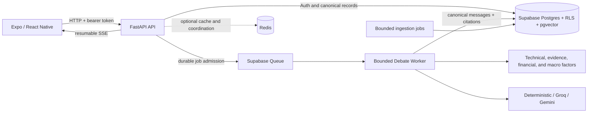

# AI Bull vs Bear

[](https://github.com/hahaArthur17/ai-bull-vs-bear/actions/workflows/ci.yml)
[](LICENSE)

AI Bull vs Bear is an educational, AI-assisted equity-research app. It turns
market data, technical indicators, company evidence, and macro context into a
citation-backed debate between Bull and Bear agents, followed by a neutral
Judge summary.

The goal is not to predict prices or tell a user what to trade. The app makes
competing interpretations, source provenance, uncertainty, and model usage
visible so a user can examine an investment narrative instead of accepting a
single generated answer.

> **Educational use only.** This project does not provide personalised
> financial advice, price predictions, or buy/sell/hold recommendations.

## What the app does

- Searches a versioned 7,695-security SEC-derived catalog and labels each
  result by data coverage. AAPL, GOOG, NVDA, and TSLA are curated
  `debate_ready` examples; catalog-only securities remain Watchlist-only.
- Presents daily and weekly price history, moving averages, RSI, MACD, volume,
  volatility, current quotes, and dated macro context without disguising stale
  or missing inputs.
- Retrieves ranked news, filing, and structured financial evidence, preserves
  source/freshness metadata, and links generated claims to valid evidence IDs.
- Runs a Bull/Bear/Judge workflow with a deterministic credential-free mode and
  optional Groq or Gemini providers.
- Supports a default-off V2 workflow with durable Queue admission, resumable
  SSE events, two debate rounds, Stop, recovery, user interjection, explicit
  Continue/End, read-only term explanation, History, and token accounting.
- Uses Supabase Auth, Postgres, Row Level Security, pgvector retrieval, and
  owner-scoped persistence when standard mode is configured.
- Keeps Redis optional: it can accelerate public reads and coordinate bounded
  rate/idempotency controls, but it never replaces canonical Supabase data.

The mobile product surface includes Sign in, security search, Watchlist, Stock
Detail, Signals, Evidence Board, Debate, Cross Examination, History, and About.

## How it works



The accepted live topology currently keeps the API, Queue consumer, Worker,
and transient SSE broker in one process. Persisted messages and checkpoints
survive restart; live deltas are not yet shared across multiple API processes.
See the [architecture overview](docs/architecture/overview.md) and
[API contract](docs/api/api-contract.md) for the detailed boundaries.

## Current status

Documentation reconciled with the repository on **2026-10-17**. Simulator
functionality is reported working by the project owner; physical-device testing
has **not been performed**. Local automated results and historical hosted/live
evidence are recorded separately below.

| Area | Status |
| --- | --- |
| Mobile and backend feature implementation | Core flow implemented, including two-round V2 Debate, Stop/interjection/Continue, History recovery, and account-state isolation |
| Backend automated suite | 542 tests passing on 2026-10-17 |
| Mobile automated suite | 122 tests, TypeScript, Expo Doctor 18/18, and Web/iOS/Android exports passing on 2026-10-17 |
| Hosted Supabase Catalog, RLS, Debate persistence, Queue, restart, and interruption checks | Passed |
| Full two-round live-model verification | Historical pass: 12/12 provider attempts, both Judges, 40 citations, resumable SSE, 39,269 reported tokens, no retry or unknown usage; refresh-time provenance still requires preflight |
| Later live interaction run | Both rounds, Stop → Explanation → interjection → Continue, Final Judge and History reopen observed; 50,380 reported Debate tokens plus one unknown-usage attempt |
| Simulator / physical device | Simulator flow reported working by the owner on 2026-10-17; **physical device not yet tested** |
| Existing Render API same-SHA deployment, cold start, restart, smoke, and rollback proof | Pending physical-device acceptance |

V2, Queue, live Turn/Judge providers, and interruptions remain explicit
feature flags; the deployed production baseline does not enable them merely
because their implementation tests passed. The authoritative project truth is
maintained in [Current Project Status](docs/planning/current-status.md), with
the remaining order in [WP8L Next Steps](docs/planning/wp8l-next-steps.md).
The later saved Session is complete; it is for read-only History review, not
another Round 2 submission. Open follow-ups include V2 in-app usage diagnostics,
hosted reopen timing, and a wholly post-source-guard audit. For the local V2
profile and two-terminal commands, start with the
[V2 Beta Resume Checklist](docs/planning/v2-beta-resume-checklist.md).

## Prerequisites

- Git
- Python **3.12 or newer** (CI uses 3.12; the runtime container uses 3.13)
- Node.js **24** and npm (verified locally and used by CI; locked Supabase
  dependencies require Node >=22)
- An Expo SDK54-compatible client or development build, plus Xcode for the iOS
  Simulator or Android Studio for the Android Emulator
- Optional for standard/live mode: an existing Supabase project and the
  provider credentials described in [Live Services Setup](docs/setup/live-services.md)

The mobile app now targets **Expo SDK 54** (`expo 54.0.37`, React Native
`0.81.5`, React `19.1.0`). The project was upgraded locally one SDK at a time
(52 → 53 → 54), and the safe-area migration plus iOS/Android native exports
have passed. These are local/build checks, not physical-device acceptance.

Check client compatibility before a physical run. Expo Go supports the latest
SDK; this repository remains on SDK54. Matching older clients are available for
Android and iOS Simulator from [expo.dev/go](https://expo.dev/go). Physical
iPhones can install only the current App Store Expo Go, so use an SDK54
development build if that client no longer supports this project. See
[Expo's SDK compatibility guidance](https://docs.expo.dev/workflow/upgrading-expo-sdk-walkthrough/).
Do not count a Web browser or native export as device acceptance.

SDK54 changes Android to mandatory edge-to-edge layout. The Android native
gate must therefore check status-bar and navigation-bar insets, bottom
navigation placement, keyboard avoidance, and back behavior; a successful
native export alone does not prove those runtime visuals.

## Quick start: deterministic review fixture

This is the safest first run. It needs no Supabase project, provider key, or
network data call. Every simulated market surface is visibly labelled.

### 1. Clone and install the backend

```shell
git clone https://github.com/hahaArthur17/ai-bull-vs-bear.git
cd ai-bull-vs-bear
cp .env.example .env

cd backend
python3 -m venv .venv
.venv/bin/python -m pip install -r requirements.txt
```

### 2. Start the local-only API

From `backend/`:

```shell
ENVIRONMENT=development APP_DATA_MODE=review_fixture \
  .venv/bin/python -m uvicorn app.main:app \
  --reload --host 0.0.0.0 --port 8000
```

The fixture profile overrides credentials and forces in-memory demo auth,
persistence, models, Queue, and cache behavior. It makes no Supabase, market,
model, or Redis request. Verify it at
[`http://localhost:8000/health`](http://localhost:8000/health); interactive API
documentation is at [`http://localhost:8000/docs`](http://localhost:8000/docs).

### 3. Start the Expo client

In a second terminal, from the repository root:

```shell
cd apps/mobile
npm ci

EXPO_PUBLIC_AUTH_MODE=demo \
EXPO_PUBLIC_DEBATE_V2_ENABLED=true \
EXPO_PUBLIC_DEBATE_INTERRUPTIONS_ENABLED=false \
EXPO_PUBLIC_API_URL=http://YOUR_COMPUTER_LAN_IP:8000 \
  npx expo start --lan --clear
```

Replace `YOUR_COMPUTER_LAN_IP` with the computer's LAN address, for example
`192.168.1.20`. On macOS, `ipconfig getifaddr en0` commonly prints the Wi-Fi
address. For a compatible iPhone client, then:

1. Install and open the compatible client described above.
2. Put the iPhone and computer on the same Wi-Fi network, and allow Expo Go
   access to the local network and camera when iOS asks.
3. Open the Metro QR/deep link using the iPhone Camera or the client's scanner.
4. Keep both terminal processes running during review.
5. Confirm `/health` reports `data_mode: "review_fixture"` and that the app
   shows its simulated-data label.

`localhost` on a physical phone points to the phone, not the development
computer. If LAN discovery is blocked by the router, Expo can tunnel the Metro
bundle with `npx expo start --tunnel`, but the phone still needs a reachable
backend URL; tunnelling Metro does not expose the FastAPI port.

For the iOS Simulator on the same computer, use loopback instead:

```shell
EXPO_PUBLIC_AUTH_MODE=demo \
EXPO_PUBLIC_DEBATE_V2_ENABLED=true \
EXPO_PUBLIC_DEBATE_INTERRUPTIONS_ENABLED=false \
EXPO_PUBLIC_API_URL=http://127.0.0.1:8000 \
  npx expo start --ios --localhost --clear
```

The standard Android Emulator reaches the workstation API at
`http://10.0.2.2:8000`; see the [mobile setup](apps/mobile/README.md).
The synchronous fixture is suitable for layout and canonical transcript
review. Use the queued standard profile for Stop/Continue and real provider
streaming acceptance.

## Controlled Expo Go standard/live acceptance

This maintainer path uses real Supabase persistence and can consume market-data
and model quota. Complete the migrations, dedicated test-user setup, freshness
preflight, and non-secret configuration in
[Live Services Setup](docs/setup/live-services.md) before using it.

Start one API/Worker/SSE process from `backend/`. Do not use `--reload` for a
quota-bearing session. This exact simulator profile reads credentials only from
the ignored root `.env` file:

```shell
ENVIRONMENT=development APP_DATA_MODE=standard \
AUTH_MODE=supabase PERSISTENCE_MODE=supabase \
ANALYSIS_PROVIDER=demo \
DEBATE_WORKFLOW_V2=true DEBATE_QUEUE_ENABLED=true \
DEBATE_INTERRUPTIONS_ENABLED=true DEBATE_JOB_MAX_ATTEMPTS=1 \
DEBATE_WORKER_CONCURRENCY=1 \
DEBATE_PROVIDER_MIN_INTERVAL_SECONDS=61 \
DEBATE_STREAMING_PROVIDER=groq \
DEBATE_STREAMING_JUDGE_PROVIDER=groq \
DEBATE_GROQ_MODEL=openai/gpt-oss-20b \
DEBATE_JUDGE_GROQ_MODEL=openai/gpt-oss-20b \
EXPLANATION_PROVIDER=deterministic \
APP_BUILD_SHA=$(git rev-parse HEAD) \
  .venv/bin/python -m uvicorn app.main:app \
  --host 127.0.0.1 --port 8000
```

Start the iOS Simulator client from `apps/mobile/`:

```shell
EXPO_PUBLIC_AUTH_MODE=supabase \
EXPO_PUBLIC_DEBATE_V2_ENABLED=true \
EXPO_PUBLIC_DEBATE_INTERRUPTIONS_ENABLED=true \
EXPO_PUBLIC_API_URL=http://127.0.0.1:8000 \
EXPO_PUBLIC_API_TIMEOUT_MS=45000 \
  npx expo start --ios --clear
```

For a physical device, also start the API with `--host 0.0.0.0`, change the
client API URL to `http://YOUR_COMPUTER_LAN_IP:8000`, and use
`npx expo start --lan --clear`. The complete acceptance order,
model-cost boundary, and post-Round-2 checks are in the
[V2 Beta Resume Checklist](docs/planning/v2-beta-resume-checklist.md).

Before creating any new live Debate, verify `/health.build_sha`, standard data
mode, the AAPL quote/bundle/evidence provenance, the current Debate list, the
declared provider-call budget, and available daily quota. The complete
model-side two-round proof already passed; prefer reopening its persisted
History/session for visual checks unless a code change specifically requires a
new live run.

The product-owner checklist is in the
[Phase 8 UI Acceptance Matrix](docs/planning/phase-8-ui-acceptance-matrix.md).
It covers data labels, charts, citations, Queue/SSE progress, Stop, recovery,
interjection, Continue/End, background/foreground behavior, force reopen,
History, accessibility, and error states.

## Configuration and secrets

Copy [`.env.example`](.env.example) to an ignored root `.env`. Defaults are
credential-free and conservative.

| Location | Examples | Rule |
| --- | --- | --- |
| Expo/public client | `EXPO_PUBLIC_API_URL`, `EXPO_PUBLIC_AUTH_MODE`, `EXPO_PUBLIC_SUPABASE_URL`, `EXPO_PUBLIC_SUPABASE_PUBLISHABLE_KEY` (or the legacy anon-key variable) | Only public configuration; Supabase RLS remains the authorization boundary |
| FastAPI/Worker only | `SUPABASE_SECRET_KEY`, `GROQ_API_KEY`, `GEMINI_API_KEY`, `FINNHUB_API_KEY`, `ALPHA_VANTAGE_API_KEY`, `FRED_API_KEY`, `EIA_API_KEY` | Never use an `EXPO_PUBLIC_` prefix and never ship these values to a device |
| Safety and rollout flags | `APP_DATA_MODE`, `DEBATE_WORKFLOW_V2`, `DEBATE_QUEUE_ENABLED`, `DEBATE_INTERRUPTIONS_ENABLED`, provider selections | Enable deliberately and verify the matching database/runtime prerequisites |

The client may contain a Supabase publishable key because it is constrained by
RLS. The Supabase secret key bypasses RLS and must remain on trusted backend or
job infrastructure. Never commit `.env`, credentials, test-user passwords,
access tokens, or screenshots/logs containing them.

## Tests

Run the primary local gates from the repository root. The test, typecheck, and
Web-export commands mirror CI; Expo Doctor adds an SDK/dependency audit.

```shell
PYTHONPATH=backend backend/.venv/bin/python -m pytest backend/tests -q

cd apps/mobile
npm run test:stream
npm run typecheck
npm run build:web
npx expo-doctor
```

`build:web` is a local compatibility check in CI. Expo Go is the product UI
acceptance entry point; the project does not use a Render static Web frontend
as a Phase 8/9 release gate.

Dependency advisories change independently of the lockfile. The audit snapshot
and its limits are recorded in the [verification record](docs/planning/phase-8-verification-record.md).
Use `npm audit` to reassess the current graph; an SDK upgrade or forced
transitive override needs its own compatibility check and native regression.

Live verification scripts are opt-in, bounded, and may consume provider quota.
Use the procedures in [Live Services Setup](docs/setup/live-services.md) rather
than running them as part of an ordinary test suite.

## Release path

The remaining release sequence is deliberately small:

1. Complete Expo Go physical-device and interface acceptance from a recorded
   commit, beginning with a compatible iPhone client; follow with Android
   SDK54 edge-to-edge checks in a native simulator or available device.
2. Deploy that accepted commit to the **existing Render API**.
3. Verify `/health.build_sha`, Auth/CORS, current data, Queue/SSE, cold start,
   restart, smoke behavior, and a recoverable rollback target.
4. Enter Phase 9 for replay, observability, resilience, and final delivery.

The project does **not** create an independent staging environment and does
**not** test or publish a Render static Web frontend as part of this path.

## Repository layout

| Path | Purpose |
| --- | --- |
| [`apps/mobile`](apps/mobile) | Expo / React Native client and mobile tests |
| [`backend/app`](backend/app) | FastAPI routes, domain services, repositories, providers, Worker, guardrails, and caching |
| [`backend/tests`](backend/tests) | Backend contract, service, persistence, Queue, SSE, and safety tests |
| [`backend/supabase`](backend/supabase) | Base schema and ordered database migrations |
| [`data/catalog`](data/catalog) | Versioned stock-identity catalog and provenance |
| [`data/demo`](data/demo) | Deterministic fixture notes and seed artifacts |
| [`scripts`](scripts) | Bounded ingestion, benchmark, migration, and verification commands |
| [`docs`](docs) | Architecture, API, database, agent, setup, planning, and verification records |

## Documentation

- [Current Project Status](docs/planning/current-status.md) — verified baseline
  and open gates
- [WP8L Next Steps](docs/planning/wp8l-next-steps.md) — active execution order
- [V2 Beta Resume Checklist](docs/planning/v2-beta-resume-checklist.md) — current local V2 test handoff and commands
- [Architecture Overview](docs/architecture/overview.md) — runtime modes and
  data flow
- [API Contract](docs/api/api-contract.md) — endpoint and SSE behavior
- [Database Schema Plan](docs/database/schema-plan.md) — Supabase/RLS/Queue
  boundaries
- [Agent Workflow](docs/agents/agent-workflow.md) — Bull/Bear/Judge lifecycle
- [Live Services Setup](docs/setup/live-services.md) — credentials, migrations,
  ingestion, quotas, and controlled acceptance
- [Issue Log](docs/planning/issue-log.md) — material incidents and mitigations

When resuming development, start with the
[planning index](docs/planning/README.md); historical weekly reports are
evidence, not the active backlog.

## License

Released under the [MIT License](LICENSE).
