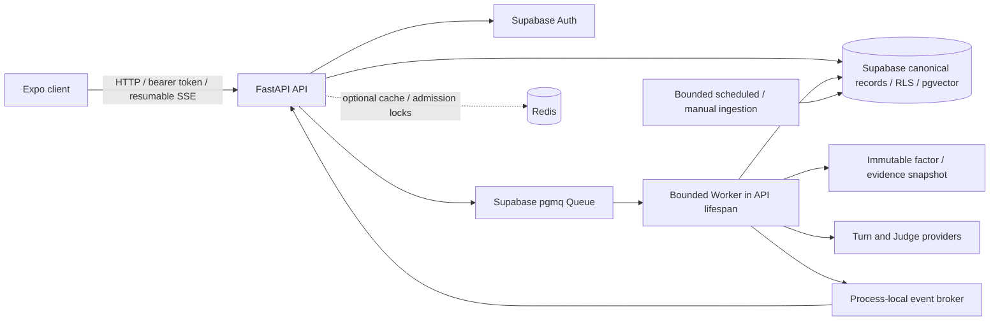

# Architecture overview

Last reviewed: 2026-10-17 against source revision `055481b`.

AI Bull vs Bear is a modular monolith with an Expo / React Native client,
FastAPI API, deterministic local stores or Supabase persistence, and optional
Queue/live-provider/cache adapters. Code availability and production enablement
are separate: V2, Queue, interruptions and live providers remain explicit flags.
See [current status](../planning/current-status.md) for verification and open gates.

## Runtime boundaries

The supported live topology keeps API, lifespan Queue consumer, Worker and SSE
broker in **one process**. Docker starts one Uvicorn Worker. Canonical messages,
Jobs, draft checkpoints and provider-attempt records survive restart; transient
live events are process-local. A standalone Worker entry point exists, but it
cannot publish into another process's broker. Multi-process/multi-instance live
streaming requires a shared event transport and replay design.

## Configuration profiles

| Profile | Behavior |
| --- | --- |
| Standard with demo defaults | In-memory data/Auth, deterministic legacy analysis, V2/Queue/interruptions/Redis off |
| Explicit `APP_DATA_MODE=review_fixture` | Local-only; overrides Auth/persistence/providers/cache, V2 on and Queue off; visibly simulated UI states with no external calls |
| Standard Supabase | Bearer Auth and owner-scoped persistence; public market/evidence caches read from Supabase |
| Queued V2 | Separately enabled durable admission, bounded Worker, async deltas, two rounds and canonical recovery |
| Live V2 | Independent explicit Groq Turn/Judge selections, freshness/admission checks and bounded provider use |

`ANALYSIS_PROVIDER` selects the legacy JSON provider (`demo`, `groq`, `gemini`).
V2 async Turns and Judges use separate deterministic/Groq selections.
Explanation is another independent deterministic/Groq provider and never
changes canonical Debate state. The [backend README](../../backend/README.md)
contains the flag map; [live services](../setup/live-services.md) contains the
credential/migration/preflight procedures.

## Catalog and market research

A versioned SEC-derived identity snapshot contains 7,695 Nasdaq/NYSE/CBOE
securities. Search is ranked and bounded to 25 results without contacting SEC,
market or model providers. Coverage is explicit: catalog-only identities can be
saved to Watchlist but cannot start research or Debate. AAPL, GOOG, NVDA and
TSLA are curated `debate_ready` examples; controlled live-data verification is
AAPL-focused and does not prove current data for all four.

The bundle endpoint combines identity, daily/weekly history, indicators,
evidence, macro context and a separately resolved quote. Completed daily closes,
weekly points, intraday quotes, missing history, stale caches and simulated
fixtures remain distinguishable. Indicators use the
[canonical formula/provenance contract](../planning/phase-8-indicator-contract.md).
Macro context is dated and does not imply causal prediction.

RSS and SEC filing ingestion preserve source/date/URL metadata. Narrative
chunks and embedding profiles are separate; the current local hash-vector
baseline is deterministic plumbing, not a learned semantic embedding.
Structured SEC XBRL facts preserve periods/units for numerical reasoning.
Ingestion runs in bounded scripts/workflows, never in catalog search. An
optional current Finnhub quote is fetched through the API and cached for 60
seconds per process.

## Debate execution

1. Authenticate, check coverage/admission, validate dated inputs and freeze one
   `AnalysisContext` / `FactorSnapshot` for the Session.
2. Atomically create Session, Job and identifier-only Queue envelope; return
   `202` when Queue is enabled. Queue-disabled preview runs synchronously and
   returns `201` with buffered compatibility events.
3. Run six mutually aware Bull/Bear Turns and an Interim Judge. Validate text,
   finish/completion, output bounds, rebuttal targets and citations before
   persisting a complete message and its evidence links.
4. Pause at `awaiting_user`. Read-only Explanation leaves state unchanged;
   explicit selected-passage Challenge atomically queues Round 2.
5. Run four Turns and a Final Judge, persist the final transcript and mark the
   Session `completed`.

Turn/Judge prompts use bounded frozen evidence, factors and transcript
projections. Streaming prose is distinct from server-owned citation/metadata
validation. Source-quote checks and financial-language guardrails constrain
output; they do not establish that every generated inference is factually true.
Historical Groq v1 content predating the source guard retains a visible warning.
The [agent workflow](../agents/agent-workflow.md) describes these boundaries.

## Stop, continuation and usage

With interruptions enabled, durable draft checkpoints support exact-prefix
Stop, including a Stop before first output. Stop atomically rotates the active
generation, removes later transcript material and preserves an explicitly
incomplete prefix in `interrupted_awaiting_user`. Old-generation writes are
rejected. It is distinct from terminal Cancel.

Saving a user interjection makes no model call. Continue requires that saved
point and atomically creates one new generation and Queue Job against the
original frozen snapshot. End settles cancellation. A non-empty frozen
interrupted prefix can be explained read-only without being treated as completed
evidence. Provider transport cancellation is best effort; work already sent
may have consumed tokens.

The provider-attempt ledger records admission, dispatch, outcome, model, and
reported/unknown usage independently of message retention. Failed or interrupted
requests must not disappear from the usage record. V2 in-app usage diagnostics
remain unimplemented; the owner-scoped audit endpoint is the current source.

## Streams and client recovery

Authenticated XHR SSE carries ordered `DebateEvent` envelopes. The bounded
broker retains 256 events for each of at most 128 Sessions. Resume uses
`Last-Event-ID` or `after_sequence`; an expired cursor returns `409` and the
client reloads canonical detail at `X-Debate-Latest-Sequence` before reconnecting.

Temporary drafts are keyed by message/generation. The reducer rejects late
old-generation changes and recovers gaps/interruption from canonical records.
The reveal scheduler displays one active bubble and drains received text before
showing later live messages; History loads canonical text directly. This is
client display pacing, not a model-request backpressure protocol.

Pending Stop storage is scoped to account/session. Account changes clear
workspace state and ignore stale prior-account HTTP responses. Screens and
shared Debate components live under `apps/mobile/src/`; `App.tsx` owns Auth,
state/navigation and orchestration. Deep-navy design tokens, safe areas, focus
and reduced-motion behavior are shared across surfaces.

## Persistence, cache and admission

Supabase is canonical for Auth-owned Watchlists, analysis history, V2 Sessions,
Messages/citations, interventions, Jobs and usage. Base schema plus ordered
migrations define grants/RLS and service-only atomic RPCs. Catalog, Debate,
Queue and interruption gates have historical hosted evidence; this documentation
refresh does not re-run hosted changes. See the
[schema plan](../database/schema-plan.md) and [Supabase setup](../../backend/supabase/README.md).

Optional Redis uses bounded timeouts and a local fallback. Public search is
cached for 30 minutes, bundle core for five minutes and eligible default V2
factor snapshots for six hours. Quotes are outside bundle caching; arbitrary
questions/context bypass shared snapshot caching. Generated agent text and
owner history are not shared cache entries.

Default admission allows one canonical non-terminal Debate and three new
admissions/hour per user. Explanation has a separate 12/hour window. Hashed
owner/idempotency locks coordinate concurrent requests; database transactions
and uniqueness remain the final duplicate-write boundary. Redis is neither
canonical history nor Queue transport.

## Remaining delivery boundaries

Simulator functionality is reported working by the owner as of 2026-10-17;
physical-device testing is not performed. Native accessibility/lifecycle,
weak-network recovery, hosted reopen timing, V2 usage UI, a wholly post-guard
source audit, and same-SHA existing-Render release/rollback evidence remain
separate follow-ups. Replay and shared cross-process event transport are future
work. Historical plans and reports are retained in [planning](../planning/README.md).
